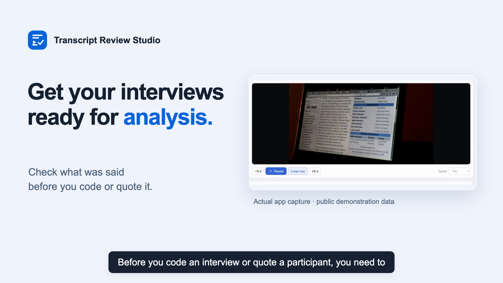

# Transcript Review Studio

### Get your interviews ready for qualitative analysis.

Transcript Review Studio is a local workspace for checking what was actually said before you code an interview or quote a participant. Generate candidate transcripts, find passages that deserve a closer listen, and make corrections while watching or listening to the recording.

**Your recordings and transcripts stay on your computer. No account, cloud transcription service, or API key is required.**

[Start with the sample](#try-it-with-the-public-sample) · [Beginner guide](docs/GETTING_STARTED.md) · [User guide](docs/USER_GUIDE.md) · [Exports](#take-your-work-into-qualitative-analysis) · [Privacy](SECURITY.md)

[](docs/media/product-tour-elevenlabs.mp4)

**[Watch the product tour · 70 seconds · English · elevenlabs.io](docs/media/product-tour-elevenlabs.mp4)** · [Video, captions and editable project](docs/media/README.md)

> **Early release for research colleagues.** The supported installation is currently **Apple Silicon macOS**. Other platforms are experimental, not release-tested. Start with the public sample and check your team's research-data requirements before importing interviews.

## Why this exists

Checking a transcript often means jumping between a media player, captions, a second transcription, and a document of corrections. This project brings those steps into one place.

The principle is simple: let local speech recognition suggest readings and help you decide where to listen next, while keeping the researcher in control of every decision. It supports preparation for qualitative analysis—not automatic coding, theme generation, or a guarantee of transcript accuracy.

## From recording to a reviewable transcript

1. **Import and process locally.** Add video or audio, optionally an existing VTT transcript and named isolated speaker tracks. Local speech-to-text generates time-aligned segments and up to two candidate passes.
2. **Focus your review.** Compare source, STT A and STT B side by side. Wording differences, heuristic recognition scores, missing versions and timing issues help prioritise passages.
3. **Listen and decide.** Preview the video, loop a cue, change playback speed, check context, edit words and speaker labels, or adjust and split segment boundaries. Open **All segments** to review anything the AI did not flag.
4. **Save the right state.** Keep a draft, mark something unclear, or explicitly save a checked segment as verified. Reviewer attribution and before/after history make decisions traceable.
5. **Export for analysis.** Take readable transcripts, structured tables, timed subtitles and a correction record into your research workflow.

Both recognition passes use **the same model with different decoding context**. They can agree on the same mistake. Recognition scores are review aids, not calibrated accuracy percentages. Nothing becomes verified just because the model is confident.

## Try it with the public sample

You can learn the complete workflow without opening a research project. A five-minute, openly licensed workshop discussion is included, along with an in-app walkthrough and a ten-step acceptance checklist.

### Requirements

- An **Apple Silicon Mac** (M-series).
- **Python 3.11+**, **Node.js 22.13+**, and **FFmpeg** including `ffprobe`.
- Internet for initial dependency and model downloads; sufficient local storage for the model and your recordings. Processing time depends on your hardware and recording length.

### First session

1. Download this repository using **Code → Download ZIP** and extract it, or clone it with Git.
2. Install the requirements above. If you already use Homebrew, FFmpeg can be installed with `brew install ffmpeg`.
3. Open **Setup Transcript Review Studio.command** once. It installs dependencies and builds the interface.
4. Open **Try Transcript Review Studio.command**. Leave its terminal window open while using the app.
5. Wait for local processing, then follow **Getting started** in the app: listen and compare → edit and decide → export and inspect.

The sample uses its **own practice database**; your research workspace is not opened. Reopening preserves your practice edits. No media download is needed with a full repository copy, but uncached model weights may download on first use.

The sample baseline contains deliberate `[practice-error]` markers for the exercise. It is generated locally and is **not a human-verified reference transcript**. See [sample provenance and CC BY-SA attribution](samples/lua-workshop/README.md).

When you are comfortable, use **Open Transcript Review Studio.command** for your own projects. For detailed setup and troubleshooting, follow the [beginner guide](docs/GETTING_STARTED.md) and [user guide](docs/USER_GUIDE.md).

## Take your work into qualitative analysis

Choose an individual export or a complete **Qualitative Analysis Package**. Draft exports remain available while review is in progress; a verified transcript requires every segment to be explicitly reviewed.

| Output | What it is useful for |
|---|---|
| **Word transcript · DOCX** | Readable, speaker-turn text with timestamps for close reading and qualitative coding. |
| **NVivo-style table · DOCX** | Timespan, Speaker and Content columns for transcript-import workflows. |
| **Excel workbook · XLSX** | Overview, Turns, Segments and Change Log worksheets for filtering and team review. |
| **Structured data · UTF-8 CSV / JSON** | Stable segment IDs, timestamps, speaker labels, review status and reusable analysis scripts. |
| **Timed captions · VTT / SRT**, plus **TXT** | Playback synchronisation and broad text compatibility. |
| **English change log and review history** | Before/after wording, review actions, reviewer attribution and unresolved decisions. |

The complete package also includes a data dictionary, transcription conventions, recording/speaker metadata, processing provenance, a manifest and SHA-256 checksums.

These formats support qualitative-analysis workflows; **import compatibility with every NVivo, MAXQDA or ATLAS.ti version is not certified**. Test a sample export in the version your team uses. This is not an automatic anonymisation tool: review direct and indirect identifiers before sharing, even when original media is excluded.

## A few useful shortcuts

| Shortcut | Action |
|---|---|
| `Space` | Play or pause the active cue |
| `1` / `2` / `3` | Use Source VTT / STT A / STT B |
| `U` | Mark unclear and advance |
| `↑` / `↓` | Navigate review segments |
| `Command–Return` | Save as verified and advance |

Shortcuts do not intercept normal typing in text fields. **Save draft** preserves work without claiming it has been verified.

## Local data, clear boundaries

Recordings, transcripts and the SQLite project database are stored outside the repository. On the supported Mac setup, the research workspace is:

```text
~/Library/Application Support/Transcript Review Studio/
```

The practice workspace is separate. The active location is shown in the app. Close the app and back up the entire data folder before upgrading.

- Speech recognition runs locally. Initial setup may download model weights from Hugging Face, but recordings and transcripts are not attached to those requests.
- The standard launcher binds the app to `127.0.0.1`. It is not a hosted service or a multiuser access-control system.
- The app does not provide encryption at rest, automatic anonymisation, secure deletion or protection against operating-system cloud backups. Use approved encrypted storage and your study's data-management policy.
- The default analysis package excludes original media **but still contains transcript content**. Including original media is a separate, explicit export choice.
- Research data, credentials and generated transcripts are blocked from this repository. The public sample and promotional assets are narrowly approved by exact file paths and checksums.

Read [Security and privacy](SECURITY.md) before working with identifiable material.

## Current limits

- **Human judgement remains essential.** Model agreement and an unflagged passage do not prove correctness.
- **Speaker labels need review.** Named isolated tracks can help assign speakers; generic automatic diarisation is not implemented. Without isolated tracks, label speakers manually.
- **Platform support is currently narrow.** The developer fallback for Windows, Linux and Intel Mac is experimental. The supplied setup and launchers support Apple Silicon macOS.
- **This is an early release.** Clean-machine installation and your team's target qualitative-software import need local acceptance testing. The [manual checklist](docs/MANUAL_TEST.md) records what still needs a person's judgement.

## Development and contributions

The interface uses Next.js/React; the local service uses Python/FastAPI, SQLite, FFmpeg and MLX Whisper on Apple Silicon.

```bash
python3 -m venv .venv
.venv/bin/python -m pip install -r backend/requirements-dev.txt
npm ci
git config core.hooksPath .githooks
```

Run the backend and frontend in separate terminals. Use an isolated data folder for development:

```bash
TRS_DATA_DIR=/tmp/transcript-review-studio-dev .venv/bin/python backend/run.py
npm run dev -- --hostname 127.0.0.1
```

Before contributing:

```bash
npm run lint
npm run build
npm audit --audit-level=moderate
.venv/bin/ruff check backend scripts
PYTHONPATH=backend .venv/bin/python -m unittest discover -s backend/tests -v
.venv/bin/pip-audit -r backend/requirements.txt --progress-spinner off
python3 scripts/privacy_check.py --history
```

The privacy guard checks staged content, working files and reachable history. Never bypass it to include research files. Use only synthetic reproductions or the attributed public sample in issues and pull requests.

[Contributing](CONTRIBUTING.md) · [Architecture](docs/ARCHITECTURE.md) · [Product definition](docs/PRODUCT.md) · [Release review](docs/RELEASE_REVIEW.md) · [Changelog](CHANGELOG.md)

## Licences and credits

The application source code and original documentation are available under the **[MIT License](LICENSE)**. This does not cover third-party media, dependencies or model weights.

The public workshop sample retains **CC BY-SA 4.0** with attribution to **Jim Carter**. The product-tour narration uses **Chris via ElevenLabs Free**, is for **noncommercial use**, and requires `elevenlabs.io` in the publication title. The app itself does not use ElevenLabs.

Read the [sample notice](samples/lua-workshop/README.md) and [promotional-media notice](docs/media/README.md) before redistributing those assets. Dependency and model licences also apply; no single software licence replaces these third-party terms.
